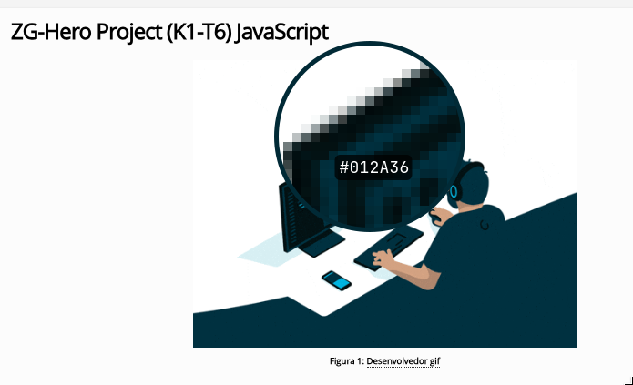

# Linketinder Front-End

Aplicação front-end em TypeScript para candidatos, empresas e vagas. Os cadastros de candidatos e empresas, consultas e login comunicam com a API Groovy; vagas, curtidas e matches ainda usam `localStorage`.
## Integração com a API

O [backend Groovy/PostgreSQL](https://github.com/Athus27/Linketinder-Project) permanece em um repositório separado. O frontend usa `fetch` para comunicar por HTTP; não acessa diretamente o banco.

Veja o [documento da integração entre frontend e backend](https://github.com/Athus27/Linketinder-Project/blob/main/docs/integracao-frontend-backend.md) para os fluxos de cadastro/login, exemplos JSON e limitações atuais.

| Recurso | Fonte dos dados atual |
|---|---|
| Visualizar candidatos | GET `/api/candidatos` pela API |
| Gerenciar candidatos | GET e DELETE `/api/candidatos`; edição ainda não integrada |
| Visualizar empresas | GET `/api/empresas` pela API |
| Visualizar vagas | GET `/api/vagas` pela API |
| Cadastro de candidato | POST `/api/candidatos` |
| Cadastro de empresa | POST `/api/empresas` |
| Cadastro de vaga | `localStorage` |
| Contadores e gráfico de competências por vaga | Consultas à API |
| Curtidas e matches | Dados locais |
| Login | POST `/api/auth/login`; perfil em memória enquanto a página está aberta |

Os formulários de candidato e empresa convertem os campos da interface para o contrato da API. Senhas são enviadas somente na requisição e não ficam no modelo ou `localStorage`. O login válido mostra nome e tipo de perfil no cabeçalho e exibe o menu correspondente; sair limpa esse estado em memória. Atualizar a página encerra esse estado local. O backend ainda não cria sessão/token nem protege os endpoints, então essa seleção de menu não é controle de acesso. Editar candidatos e editar/excluir vagas ainda não estão integrados. Curtidas e matches permanecem locais; contadores e gráficos consultam o backend.

## Como executar

É necessário ter Node.js e npm instalados. Na raiz deste repositório, crie `.env`, ao lado de `package.json`:

```dotenv
# .env — endereço do backend local
VITE_API_URL=http://localhost:8080
```

O service lê `import.meta.env.VITE_API_URL` e acrescenta `/api/candidatos`. Reinicie o Vite após alterar a configuração. O `.env` é ignorado pelo Git; variáveis com prefixo `VITE_` são expostas ao frontend e não devem conter senhas.

Inicie o PostgreSQL e o backend conforme seu README. Em outro terminal, na raiz do frontend:

```bash
npm install
# Instala as dependências do frontend.
npm run dev
# Inicia o servidor de desenvolvimento do Vite.
```

Abra o endereço informado pelo Vite, normalmente `http://localhost:5173`.

**CORS:** o backend autoriza por padrão `http://localhost:5173` e trata o preflight `OPTIONS` de POST JSON. Se o Vite usar outra porta ou hostname, configure `FRONTEND_ORIGIN` no backend com a origem exata e reinicie a API. A variável `VITE_API_URL` configura o destino da consulta, enquanto `FRONTEND_ORIGIN` configura quem pode ler a resposta no navegador. CORS não sincroniza dados locais nem cria sessão; o login atual apenas valida credenciais e ajusta a interface.

As páginas remotas mostram carregamento, lista vazia e erro de consulta. Os testes no Node não substituem a verificação do fluxo no navegador.

```bash
npm run build
# Verifica os tipos e gera a versão de produção em dist.
npm run preview
# Disponibiliza localmente a versão gerada para inspeção.
```

## Testes

```bash
npx vitest run tests/services/*.test.ts tests/controllers/*.test.ts --exclude "**/*.integration.test.ts"
# Executa os testes unitários com dependências simuladas, sem consultar a API real.
```

```bash
npx vitest run tests/services/CandidateService.integration.test.ts
# Consulta a API real configurada no .env e imprime os candidatos; exige backend e banco disponíveis.
```

O teste de integração atual serve para inspecionar o retorno: não possui asserções para validar seu conteúdo. `npm run test:run` executa todos os testes, inclusive essa consulta real; `npm test` os executa em modo de observação.

## Arquitetura
> estrutura de pastas seguindo um princípio de mvc, gerada usando o comando `tree -I 'node_modules|dist|.git' -L 3` **e editado para melhor visualização**

### Responsabilidades
O ponto de entrada é `main.ts` que instancia `LinketinderApp()` (estado e regras locais do frontend) e chama `renderAll()` para orquestrar o front. Cada **página/componente é responsável** pelos métodos necessários para o componente funcionar, por exemplo o `Header` contém *toggleSubmenu* que é uma função utilizada para o funcionamento correto do header.

### estilização
Como o módulo desse curso de TS e o contexto do desafio era focar no front-end, utilizei minha experiencia prévia de designer gráfico (confira aqui >> https://www.behance.net/athussilvasouza) pra tentar desenvolver um design limpo e agradável, utilizei regras de contraste para escolher as cores, mas me baseei na imagem do desafio (gosto muito de tons de azul). Usei essas regras e somado com o que aprendi no curso de html + css padronizei as cores e defini regras globais em `styles/global.css` e deixei as específicas no mesmo nível do componente/página. **Deixo claro que não utilizei react**. A imagem que me baseei para criar a paleta de cores:


#### Grafico de Skills
> utiliza biblioteca `chart.js` para criar um gráfico a partir de uma `Job`, e retorna um grafico de contagem de frequencia das competencias para aquela vaga

#### estrutura de pastas

```text
src/
├── app/                  # Estado, regras e persistência locais
├── controllers/          # Coordenação das chamadas aos services
├── services/             # Comunicação HTTP e conversão da resposta
├── models/               # Candidate, Company, Job, Like e User
├── types/                # Tipos de entrada e contratos CandidateResponse, CompanyResponse e JobResponse
├── view/
│   ├── components/       # Formulários, cartões, layout e gráficos
│   └── pages/            # Composição das páginas
├── styles/
├── main.ts
└── renderAll.ts
tests/
├── controllers/
└── services/
```

Na consulta remota, `renderAll` cria o controller e fornece à página uma função de busca. A página aguarda a lista; o controller chama o service; o service executa GET e transforma cada resposta em uma instância de `Candidate`, preservando o ID do banco como string. Os campos `nome`, `dataNascimento` e `competencias` viram `name`, `birthDate` e `skills`. Como a API não retorna estado, `state` fica vazio.

A interface é construída diretamente com a API do DOM. O `LinketinderApp` concentra as regras de negócio e o acesso ao `localStorage`,o `renderAll` controla a exibição e interação do usuário enquanto as páginas coordenam os componentes exibidos. Para gerar um id aleatório para estrutura de vaga utilizei o `crypto.randomUUID()`, que gera um id de forma segura. 
#### gitdiagram
> ferramenta para visualizar melhor e entender os fluxos, os links são clicáveis

```mermaid
%% Generated by https://gitdiagram.com/athus27/linketinder-frontend
flowchart TD

subgraph group_ui["Interface and navigation"]
  node_boot["App entry<br/>[main.ts]"]
  node_navigation["Page navigation<br/>[renderAll.ts]"]
  node_header["Menu header<br/>[Header.ts]"]
  node_info["Info section<br/>[InfoSection.ts]"]
end

subgraph group_profiles["Profiles and jobs"]
  node_registration["Registration page<br/>[RegisterPage.ts]"]
  node_userform["Profile form<br/>[UserForm.ts]"]
  node_candidatefeed["Candidate feed"]
  node_candidatecard["Candidate card"]
  node_companyfeed["Company feed<br/>[CompanyFeedPage.ts]"]
  node_companycard["Company card"]
  node_jobregister["Job registration<br/>[JobRegisterPage.ts]"]
  node_jobform["Job form<br/>[JobForm.ts]"]
  node_jobfeed["Job feed<br/>[JobFeedPage.ts]"]
  node_jobcard["Job card<br/>[JobProfileCard.ts]"]
end

subgraph group_matching["Likes and matches"]
  node_candidate_like["Candidate likes"]
  node_company_like["Company likes<br/>[CompanyLikePage.ts]"]
end

subgraph group_domain["Domain and persistence"]
  node_app["Business and storage<br/>[LinketinderApp.ts]"]
  node_models["Domain entities<br/>[Like.ts]"]
end

node_person(("Browser user"))
node_localstorage[("Browser localStorage")]

node_boot -->|"instantiates"| node_app
node_boot -->|"starts rendering"| node_navigation
node_person -->|"uses menu"| node_header
node_header -->|"invokes actions"| node_navigation
node_navigation -->|"creates"| node_header
node_navigation -->|"creates"| node_info
node_navigation -->|"selects page"| node_registration
node_navigation -->|"selects page"| node_candidatefeed
node_navigation -->|"selects page"| node_companyfeed
node_navigation -->|"selects page"| node_jobregister
node_navigation -->|"selects page"| node_jobfeed
node_navigation -->|"selects page"| node_candidate_like
node_navigation -->|"selects page"| node_company_like
node_registration -->|"coordinates"| node_userform
node_jobregister -->|"coordinates"| node_jobform
node_candidatefeed -->|"displays"| node_candidatecard
node_candidatefeed -->|"função de busca remota"| node_controller["CandidateController"]
node_controller --> node_service["CandidateService"]
node_service -->|"GET /api/candidatos"| node_api["API Groovy / PostgreSQL"]
node_companyfeed -->|"displays"| node_companycard
node_jobfeed -->|"displays"| node_jobcard
node_userform -->|"creates profiles"| node_app
node_jobform -->|"creates jobs"| node_app
node_candidate_like -->|"submits candidate like"| node_app
node_company_like -->|"submits company like"| node_app
node_app -->|"uses entities"| node_models
node_app -->|"loads and saves"| node_localstorage

click node_boot "https://github.com/athus27/linketinder-frontend/blob/main/src/main.ts"
click node_navigation "https://github.com/athus27/linketinder-frontend/blob/main/src/renderAll.ts"
click node_header "https://github.com/athus27/linketinder-frontend/blob/main/src/view/components/layout/Header.ts"
click node_info "https://github.com/athus27/linketinder-frontend/blob/main/src/view/components/layout/InfoSection.ts"
click node_registration "https://github.com/athus27/linketinder-frontend/blob/main/src/view/pages/RegisterPage.ts"
click node_userform "https://github.com/athus27/linketinder-frontend/blob/main/src/view/components/forms/UserForm.ts"
click node_candidatefeed "https://github.com/athus27/linketinder-frontend/blob/main/src/view/pages/CandidateFeedPage.ts"
click node_candidatecard "https://github.com/athus27/linketinder-frontend/blob/main/src/view/components/cards/CandidateProfileCard.ts"
click node_companyfeed "https://github.com/athus27/linketinder-frontend/blob/main/src/view/pages/CompanyFeedPage.ts"
click node_companycard "https://github.com/athus27/linketinder-frontend/blob/main/src/view/components/cards/CompanyProfileCard.ts"
click node_jobregister "https://github.com/athus27/linketinder-frontend/blob/main/src/view/pages/JobRegisterPage.ts"
click node_jobform "https://github.com/athus27/linketinder-frontend/blob/main/src/view/components/forms/JobForm.ts"
click node_jobfeed "https://github.com/athus27/linketinder-frontend/blob/main/src/view/pages/JobFeedPage.ts"
click node_jobcard "https://github.com/athus27/linketinder-frontend/blob/main/src/view/components/cards/JobProfileCard.ts"
click node_candidate_like "https://github.com/athus27/linketinder-frontend/blob/main/src/view/pages/CandidateLikePage.ts"
click node_company_like "https://github.com/athus27/linketinder-frontend/blob/main/src/view/pages/CompanyLikePage.ts"
click node_app "https://github.com/athus27/linketinder-frontend/blob/main/src/app/LinketinderApp.ts"
click node_models "https://github.com/athus27/linketinder-frontend/blob/main/src/models/Like.ts"

classDef toneNeutral fill:#f8fafc,stroke:#334155,stroke-width:1.5px,color:#0f172a
classDef toneBlue fill:#dbeafe,stroke:#2563eb,stroke-width:1.5px,color:#172554
classDef toneAmber fill:#fef3c7,stroke:#d97706,stroke-width:1.5px,color:#78350f
classDef toneMint fill:#dcfce7,stroke:#16a34a,stroke-width:1.5px,color:#14532d
classDef toneRose fill:#ffe4e6,stroke:#e11d48,stroke-width:1.5px,color:#881337
classDef toneIndigo fill:#e0e7ff,stroke:#4f46e5,stroke-width:1.5px,color:#312e81
classDef toneTeal fill:#ccfbf1,stroke:#0f766e,stroke-width:1.5px,color:#134e4a
class node_boot,node_navigation,node_header,node_info,node_person toneBlue
class node_registration,node_userform,node_candidatefeed,node_candidatecard,node_companyfeed,node_companycard,node_jobregister,node_jobform,node_jobfeed,node_jobcard,node_localstorage toneAmber
class node_candidate_like,node_company_like toneMint
class node_app,node_models toneRose
```


## Listagem remota de empresas e vagas

`renderAll` cria `CompanyController`/`CompanyService` e `JobController`/`JobService` e fornece funções de busca às páginas. `CompanyFeedPage` e `JobFeedPage` aguardam os dados e mostram carregamento, lista vazia ou erro de consulta.

O `CompanyService` transforma `nome`, `descricao`, `pais` e `cep` em `name`, `description`, `country` e `cepCode`. Como a API não devolve estado, `state` fica vazio. O `JobService` transforma `titulo`, `descricao`, `idEmpresa` e `competencias` em `title`, `description`, `companyId` e `skills`. O modelo atual de vaga não exibe `empresa` nem `localVaga`. Os IDs dos registros e da empresa vinculada à vaga são preservados como strings; as respostas são convertidas em instâncias de `Company` e `Job`.

Os testes unitários dos services verificam conversão, preservação dos IDs, lista vazia, falha HTTP e falha de conexão. Os testes dos controllers verificam retorno da lista e propagação de erros. A InfoSection consulta empresas, candidatos e vagas da API; falhas aparecem como indisponibilidade, não como zero. O gráfico carrega vagas e candidatos do backend e conta quantos candidatos possuem cada competência exigida pela vaga selecionada.
